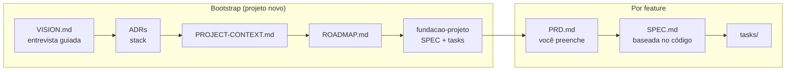

# Skills

[](./LICENSE)


Skills reutilizáveis para agentes de IA, no padrão `SKILL.md`. Instale com um comando em qualquer projeto ou máquina e mantenha o mesmo fluxo de trabalho em todos os agentes.

```bash
npx skills add luunando/skills --skill spec-driven-build
```

## Skills disponíveis

| Skill | Categoria | Descrição |
|---|---|---|
| [`spec-driven-build`](./skills/development/spec-driven-build/SKILL.md) | development | Da ideia às tasks: visão, ADRs, PRD, SPEC e tasks com gates de qualidade e histórico por feature. |

### spec-driven-build

Conduz uma feature do problema até tasks implementáveis, com pausas para você aprovar cada etapa. Nada vira SPEC sem PRD validado, e nada vira task sem SPEC aprovada.

Em projeto novo, começa pelo **Bootstrap**: uma entrevista guiada (uma pergunta por vez, sempre com uma resposta recomendada) para montar a visão do produto, ADRs para escolher a stack e um roadmap do MVP.



O que fica em `docs/`:

```text
docs/
  VISION.md
  ROADMAP.md
  PROJECT-CONTEXT.md
  adr/ADR-001-stack.md
  <feature>/
    PRD.md
    SPEC.md
    tasks/TASK-1-....md … TASK-N-verificacao-e2e.md
```

Para usar: `/spec-driven-build <descrição da feature ou da ideia do projeto>`

## Instalação

Listar as skills:

```bash
npx skills add luunando/skills --list
```

Instalar no projeto atual:

```bash
npx skills add luunando/skills --skill <nome>
```

Instalar globalmente, sem prompts:

```bash
npx skills add luunando/skills --skill <nome> -g -y
```

### Sem CLI

1. Clone o repositório.
2. Copie a pasta da skill para o diretório de skills do seu agente (ex.: `~/.claude/skills/`).
3. A skill lê `references/` e `templates/` sozinha, quando precisa.

## Estrutura

```text
skills/
  <categoria>/
    <nome-da-skill>/
      SKILL.md        frontmatter com name e description
      references/     guias longos, lidos sob demanda
      templates/      modelos de arquivos
      scripts/        helpers determinísticos
      assets/         arquivos estáticos
templates/
  skill-template/     ponto de partida para novas skills
```

Categorias: `development`, `design`, `productivity`, `others`.

## Contribuição

1. `cp -r templates/skill-template skills/<categoria>/<nome>`
2. Preencha o `SKILL.md`. A `description` deve dizer o que a skill faz e quando usar.
3. Teste com `npx skills add ./ --list`.
4. Adicione a skill na tabela acima e atualize o badge de contagem.

Detalhes e checklist em [CONTRIBUTING.md](./CONTRIBUTING.md).

## Créditos

`spec-driven-build` é derivada de [jjeanjacques10/skills](https://github.com/jjeanjacques10/skills) (MIT). A licença original está em [`skills/development/spec-driven-build/LICENSE`](./skills/development/spec-driven-build/LICENSE). A técnica de entrevista do Bootstrap se inspira nas skills `grilling` e `grill-me`.

## Licença

MIT. Veja [LICENSE](./LICENSE).
